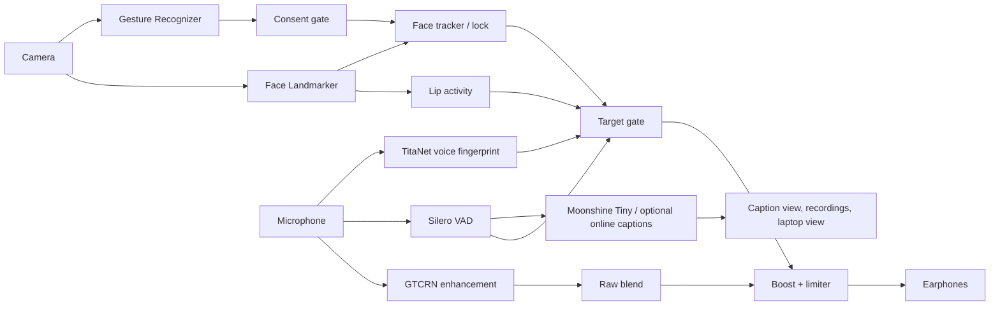
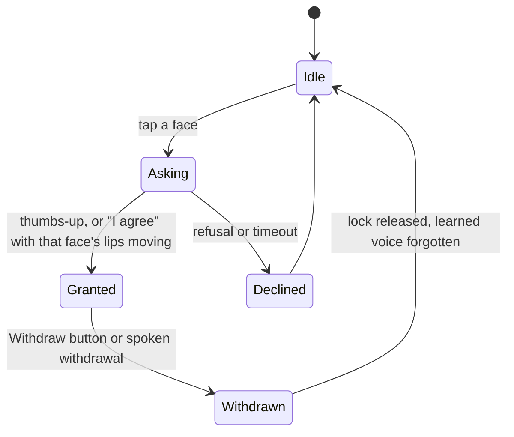
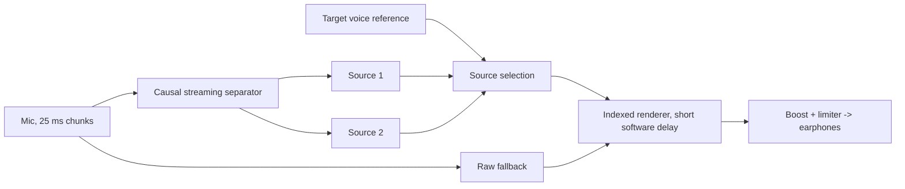

# Architecture

Kotlin, Jetpack Compose, CameraX, MediaPipe Tasks Vision, and sherpa-onnx (ONNX Runtime) for the audio models. Audio and vision inference run on the phone.

## Overview

## Modules

Package `com.akashrajeev.voicebeam`:

| Package | Role |
|---|---|
| `core` | Pure Kotlin logic with unit tests: target gate, lip activity, face tracker, voice match, consent gate and log, caption transcript handling, diagnostics |
| `engine` | Audio pipeline (mic thread: enhancement, gate, boost, limiter, earphone output), engine (models, face lock, consent, enrollment, recording, state), voice learner, settings, encrypted key store, optional online caption client |
| `ml` | Model wrappers: GTCRN, TitaNet Small, Silero VAD, Moonshine Tiny via sherpa-onnx |
| `vision` | CameraX analyzer, MediaPipe face landmarks, hand gestures |
| `record` | Session storage and export of audio or audio with video and captions (Media3) |
| `stage` | Small local HTTP server for the laptop caption view |
| `ui` | Compose screens: Setup, Focus, Captions, Sessions, Settings |

## Models

| Model | Role | Runtime |
|---|---|---|
| MediaPipe Face Landmarker | face detection, landmarks, lip activity | MediaPipe Tasks Vision |
| MediaPipe Gesture Recognizer | thumbs-up consent | MediaPipe Tasks Vision |
| GTCRN | speech enhancement | sherpa-onnx |
| Silero VAD v5 | speech activity | sherpa-onnx |
| TitaNet Small | speaker embedding | sherpa-onnx |
| Moonshine Tiny (en, int8) | on-device captions | sherpa-onnx |

## Consent flow

- Tapping a face opens a permission request for that person.
- A held thumbs-up, or the spoken phrase "I agree" while that face's mouth moves, grants consent.
- On grant the lock starts, the back-camera torch blinks twice, and a local log entry is written.
- Withdrawal is always available: a button, or phrases such as "I withdraw". It unlocks the face and clears the learned voice.
- Consent records stay on the device and can be deleted from Settings.

## Signal flow (ENH track)

1. Camera frames give face landmarks and lip activity for the locked face and the others.
2. Microphone audio is enhanced (GTCRN) and blended with some raw audio.
3. The target gate combines lip activity, voice activity and the voice match score into a target probability and a smoothed gain. Others are turned down by the Quiet Others setting.
4. A limiter follows the boost so peaks stay safe.
5. Output goes to earphones. Route selection prefers A2DP, LE, wired and USB media routes.
6. Captions use the raw audio path: Silero VAD cuts utterances and Moonshine Tiny transcribes. The gate state labels who spoke.

## SEP track (separation design)

- A SkiM-style causal separator keeps state between short chunks and returns two sources.
- A target-voice reference, learned from the locked person speaking alone, chooses the source to follow.
- An indexed renderer writes the chosen source to the output with a short software delay.
- A raw-audio fallback runs alongside, so output continues through warm-up, uncertain selection and any separator error.

## Pipeline behavior

- Raw audio for captions, enhanced audio for listening.
- Gate decisions use fresh evidence; stale voice matches expire.
- The caption queue is bounded and drops the oldest entries, counted in diagnostics.
- The online captioner is optional, needs the user's own key (kept in an encrypted store on the phone) and is off by default.
- Models are released on stop.
